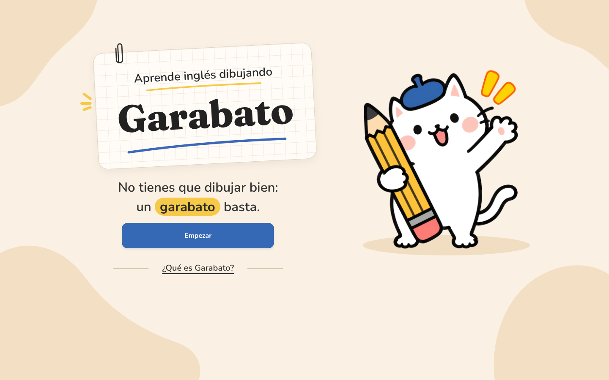
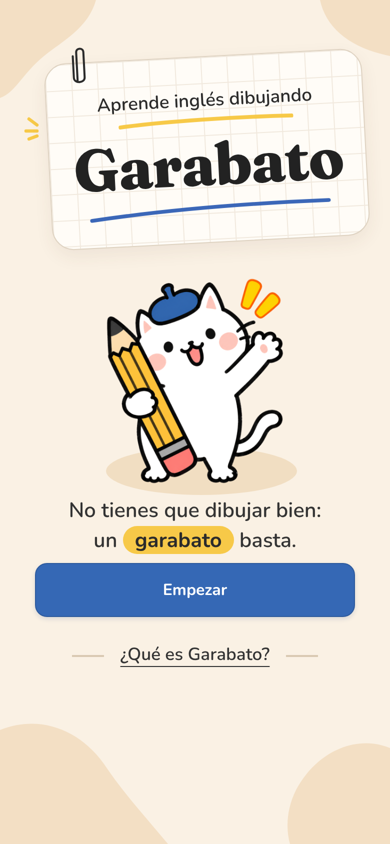
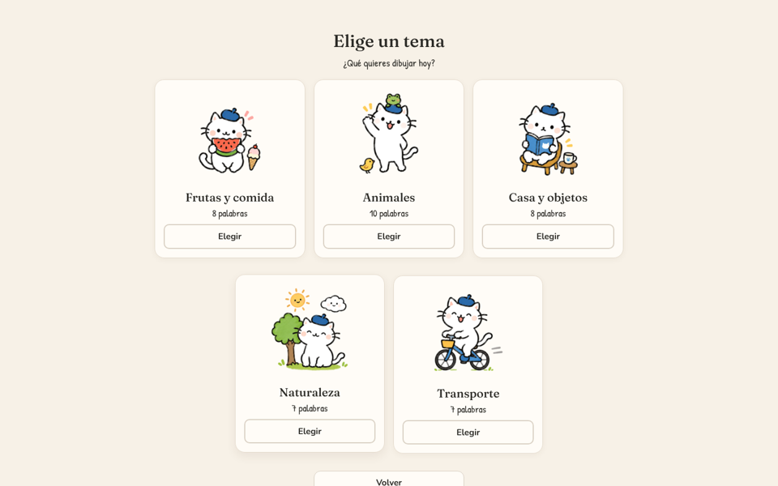
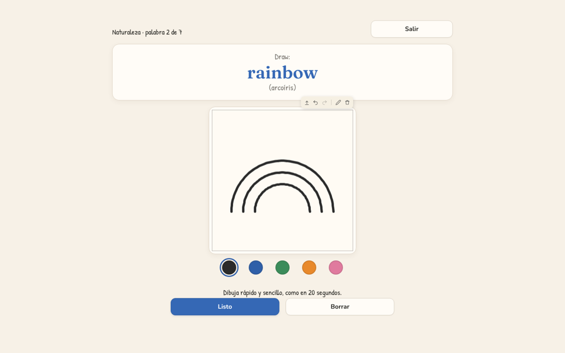
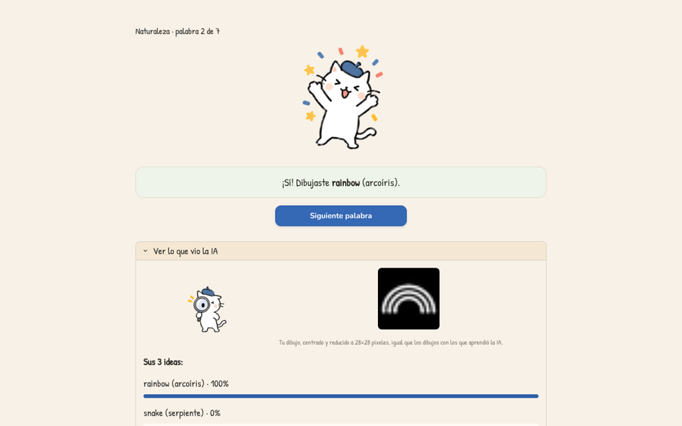
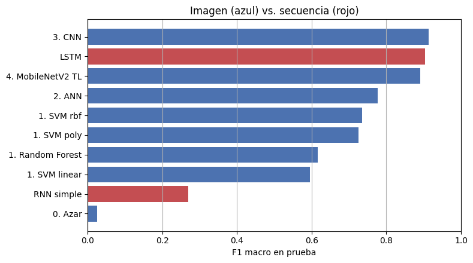
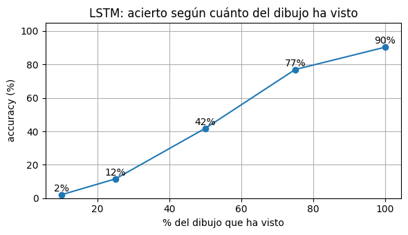
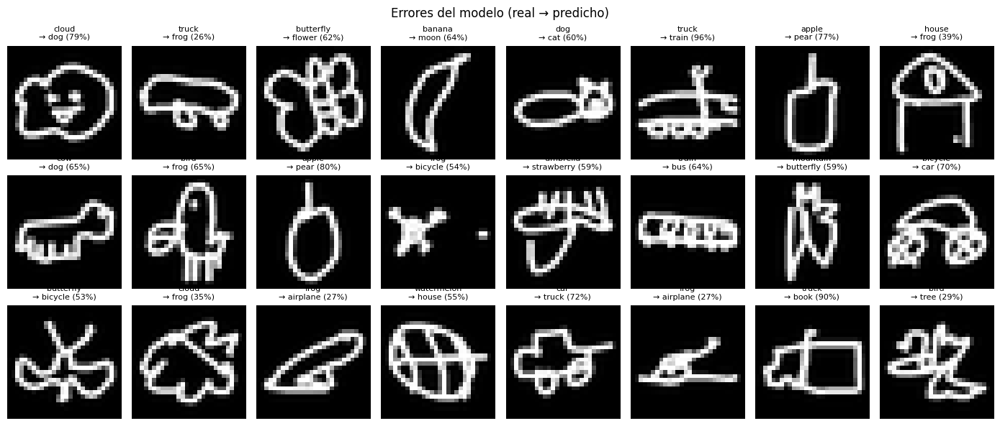

# Garabato

**Aprende inglés dibujando.** Garabato te muestra una palabra en inglés, tú la dibujas y una red neuronal intenta reconocer tu dibujo. No tienes que dibujar bien: un garabato basta.

<p align="center">
  
  
</p>

## ¿Para quién y por qué?

Para personas que están empezando con el inglés y prefieren aprender creando, sin importar la edad ni si "saben dibujar".

La idea se apoya en el **efecto del dibujo**: en una serie de experimentos, las palabras que las personas dibujaban se recordaban mejor que las que escribían (Wammes, Meade y Fernandes, 2016, *Quarterly Journal of Experimental Psychology*, 69(9)). Ese estudio midió el recuerdo de palabras, no el aprendizaje de un segundo idioma; Garabato es un prototipo que aplica esa idea al vocabulario en inglés.

## Cómo funciona

| Elige un tema | Dibuja | La IA responde |
|---|---|---|
|  |  |  |

1. El lienzo guarda los **trazos** (las coordenadas del lápiz).
2. `dibujos.py` los centra, los dibuja en 256×256 y los reduce a **28×28 píxeles**. Es exactamente la misma función que se usó para preparar los datos de entrenamiento, para que el modelo vea en la app lo mismo que vio al aprender.
3. Una **CNN** devuelve la probabilidad de cada una de las 40 palabras.
4. Si la probabilidad más alta es menor que el umbral (0,77), la app dice **"no estoy segura"** en lugar de adivinar.

## Datos

- [*Quick, Draw!*](https://github.com/googlecreativelab/quickdraw-dataset) de Google (licencia CC BY 4.0): dibujos hechos en 20 segundos por jugadores de todo el mundo.
- **40 palabras en 5 temas:** frutas y comida, animales, casa y objetos, naturaleza, transporte.
- 8.000 dibujos reconocidos por palabra → **224.000** para entrenar, **48.000** para validar y **48.000** para probar.
- Dos pruebas extra que el modelo nunca vio al entrenar:
  - **40.000 dibujos que el juego de Google no reconoció** (los más difíciles).
  - **7.732 dibujos hechos en Colombia.**

## Modelos

Se compararon los modelos vistos en el curso, de lo más simple a lo más complejo. El modelo de la app se eligió con el conjunto de **validación**; la prueba solo confirma.

| Modelo | Qué ve | F1 macro (prueba) |
|---|---|---|
| Azar | nada | 0,03 |
| SVM lineal / RBF / polinomial (con PCA) | píxeles sueltos | 0,60 / 0,74 / 0,73 |
| Random Forest | píxeles sueltos | 0,62 |
| ANN (red densa) | píxeles sueltos | 0,78 |
| **CNN**  | formas en la imagen | **0,91** |
| MobileNetV2 (transfer learning + fine-tuning) | formas, con lo aprendido de fotos | 0,89 |
| RNN simple | el trazo como secuencia | 0,27 |
| LSTM | el trazo como secuencia | 0,90 |

<p align="center"></p>

- **CNN contra ANN:** la ANN ve 784 píxeles sin saber cuáles son vecinos; la CNN reconoce formas (ruedas, orejas, pétalos) en cualquier parte del dibujo.
- **Transfer learning:** lo aprendido de fotos (ImageNet) no se transfiere tan bien a dibujos de línea, y el modelo es más pesado.
- **RNN simple contra LSTM:** la RNN simple "olvida" el comienzo de una secuencia de 128 pasos (gradiente que desaparece); las compuertas de la LSTM lo resuelven.
- **La app usa la CNN:** mejor F1 en validación, solo necesita el dibujo terminado y es liviana (3,8 MB).

La LSTM además permite ver qué tan pronto adivina mientras se dibuja: con el 75 % del dibujo ya acierta el 77 % de las veces.

<p align="center"></p>

## Dónde falla

- **El 91 % es con dibujos que Google ya había reconocido**, o sea, los más claros. Con los dibujos que el juego no reconoció, el modelo solo se atreve a responder en el 45 % de los casos y acierta el 67 % de esas veces. Ese es el número honesto para alguien que dibuja muy distinto.
- **Con dibujos de Colombia** funciona igual que con el resto: responde el 87 % de las veces y acierta el 97 %.
- **Las palabras más difíciles son animales**, las mismas que la gente dibuja peor en el juego: perro (F1 0,67), rana (0,75), camión (0,80), elefante y vaca (0,84–0,85).
- **Confusiones más comunes:** perro → vaca (10 %), camión → bus (9 %), perro → elefante (8 %) y banano ↔ luna (7 %).

<p align="center"></p>

## Limitaciones

- Solo conoce 40 palabras: si dibujas otra cosa, igual intentará adivinar una de ellas.
- Aprendió de garabatos rápidos; con dibujos muy detallados o con sombras puede fallar.
- Las métricas vienen de dibujos de *Quick, Draw!*, no de personas aprendiendo inglés. Comprobar si la app ayuda a aprender vocabulario sería el siguiente paso.
- Si el navegador traduce la página automáticamente, cambia las palabras en inglés. Desactiva la traducción para este sitio.

## Estructura del repositorio

```
Garabato/
├── app.py                 # la app (Streamlit)
├── dibujos.py             # convierte los trazos en imagen 28×28 (igual que en el entrenamiento)
├── requirements.txt
├── .streamlit/config.toml # colores del tema
├── modelo/                # CNN entrenada, palabras, temas y umbral
├── imagenes/              # ilustraciones del gato y stickers
├── notebooks/
│   ├── 1_Datos.ipynb      # descarga, render 28×28, EDA y partición
│   ├── 2_Modelos.ipynb    # SVM, RF, ANN, CNN, transfer learning, evaluación y umbral
│   └── 3_LSTM.ipynb       # RNN simple y LSTM sobre los trazos
└── docs/                  # capturas y gráficas de este README
```

## Cómo correrla

Necesitas Python 3.10 a 3.13 (TensorFlow 2.21 todavía no funciona con 3.14).

```bash
git clone https://github.com/KarenOsorio14/Garabato.git
cd Garabato
python -m venv .venv
source .venv/bin/activate        # en Windows: .venv\Scripts\activate
pip install -r requirements.txt
streamlit run app.py
```

Los notebooks están pensados para Google Colab con GPU. El paso 1 descarga los datos de *Quick, Draw!*.

## Créditos

- Datos: [*Quick, Draw!*](https://github.com/googlecreativelab/quickdraw-dataset), Google, CC BY 4.0.
- Ilustraciones del gato y stickers: generadas con IA y editadas para la app.
- Efecto del dibujo: Wammes, J. D., Meade, M. E. y Fernandes, M. A. (2016). The drawing effect: Evidence for reliable and robust memory benefits in free recall. *Quarterly Journal of Experimental Psychology*, 69(9), 1752.
